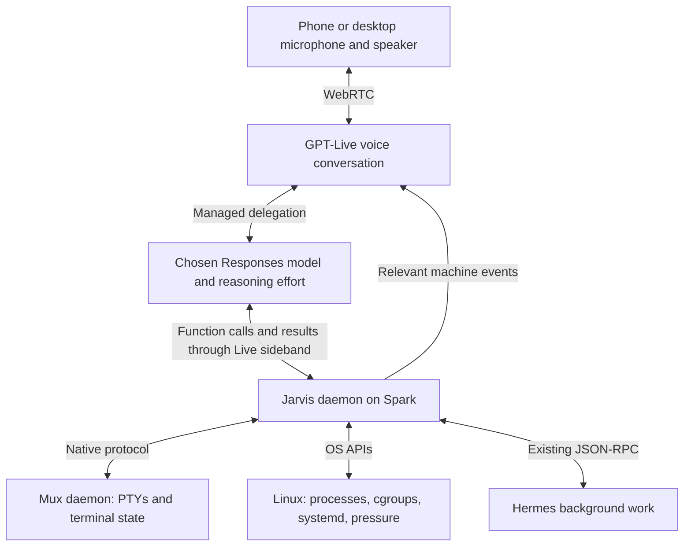

# Jarvis: GPT-Live, Linux, and Mux

Research checked September 10, 2026. This is an architecture assessment from official documentation, a source audit, and read-only host inspection. No voice prototype, paid API call, or service change was made. Recommendations below are proposed design, not tested behavior.

## What the new release changes

**GPT-Live 1 (`gpt-live-1`) became generally available on September 10.** GPT-Realtime-2.1 was released July 6; it is not the new release relevant here. GPT-Live separates continuous voice interaction from a configurable reasoning backend. Its voice frontend can listen while speaking and keep conversing while delegated work runs. [API changelog](https://developers.openai.com/api/docs/changelog), [GPT-Live overview](https://developers.openai.com/api/docs/guides/live)

For Jarvis, the consequence is that selecting a more capable or slower backend need not make the conversational interface unavailable. Consider: “Investigate why the build is stuck,” followed by “While that runs, what else is using memory?” The system needs to keep listening and discussing the situation while inspection and reasoning continue. This is a product scenario to validate, not a measured latency claim.

The documented migration changes who owns conversational timing: an older Realtime application works with speech turns and response events; Live consumes continuous audio and decides when to speak. Task reasoning and structured tool selection move to the chosen backend. Application code still executes functions and owns durable state. This reduces the conversation plumbing we need to invent; it does not introduce new Linux privileges or automatic understanding of arbitrary programs. [Migration guide](https://developers.openai.com/api/docs/guides/live-migration)

Talking while a function runs was already possible with Realtime's asynchronous function calling. The new value is the explicit separation of full-duplex voice from independently configurable backend reasoning, with hosted context and connection management. Avoid describing background tool execution itself as newly possible. [Earlier Realtime developer notes](https://developers.openai.com/blog/realtime-api#asynchronous-function-calling)

## How much backend control OpenAI exposes

**Backend model selection and reasoning effort are available now.** There are two integration modes:

| Mode | OpenAI provides | Jarvis supplies |
| --- | --- | --- |
| Managed Responses delegation | Conversation context preparation, connection to the configured Responses model, and delivery of its results to the voice frontend | Backend model/settings, instructions, tool definitions, local function execution, authoritative task state |
| Client delegation | Voice conversation and delegation notifications | Context assembly, any model/service/harness, routing, fallbacks, execution, and returning results |

The guide explicitly suggests GPT-5.6 Terra as a starting backend and GPT-5.6 Luna for cost-sensitive work. These are examples, not evidence that every Responses model is accepted by every project. [Delegation guide](https://developers.openai.com/api/docs/guides/live-delegation)

The managed configuration exposes these controls under `delegation.responses`:

| Field | Meaning |
| --- | --- |
| `model` | Choose task reasoning independently of `gpt-live-1` |
| `reasoning.effort` | Choose supported reasoning effort for that backend |
| `instructions` | Backend workflow and tool-use instructions, separate from voice style |
| `tools`, `tool_choice` | Available tools and whether/how the backend selects them |
| `parallel_tool_calls` | Permit independent function calls together |
| `max_output_tokens` | Bound backend output |
| `service_tier` | Supported service tier, subject to model/project access |

Settings can change during a conversation through `session.update`, for subsequent delegated requests; this does not swap the model underneath existing work. Omitted settings remain unchanged. This makes changing the backend model or effort without replacing the voice session a documented capability. It is not a documented automatic difficulty router. `response.create` uses session configuration and does not accept its own model override. The delegation mode itself is fixed for the session; changing managed/client mode requires a new session. [Live API schema](https://developers.openai.com/api/reference/resources/live)

A configuration excerpt, not a complete application:

```json
{
  "model": "gpt-live-1",
  "delegation": {
    "type": "responses",
    "responses": {
      "model": "gpt-5.6-luna",
      "reasoning": { "effort": "low" }
    }
  }
}
```

Luna and Terra both document `low` reasoning. Select only effort levels accepted by both the model and the Live configuration. The fetched Live schema goes up to `xhigh`; standalone model support for `max` does not establish managed Live support for it. [Luna model](https://developers.openai.com/api/docs/models/gpt-5.6-luna), [Terra model](https://developers.openai.com/api/docs/models/gpt-5.6-terra), [Live schema](https://developers.openai.com/api/reference/resources/live)

For an application-controlled “small model for quick status, larger model for difficult diagnosis” policy, choose client delegation when per-request routing, multiple backends, context filtering, or custom budgets are essential. That backend can be Hermes or a service using local inference. A small model is not intrinsically required: voice and backend are separate choices. No unreleased roadmap is needed for these capabilities.

**Recommended initial choice: managed Responses delegation.** It best matches the request for an out-of-the-box GPT harness. For the clarified use case of discussing and directing five existing Codex sessions, evaluate Astra as the shared reasoning backend, initially at low or medium effort; the Luna configuration above illustrates the cheaper option. Give the backend a small set of functions implemented on Spark, including an asynchronous Hermes submission function. Introduce custom backend routing only after measurements show a need. This keeps the persistent machine model independent of either model provider or agent harness. Astra supports Responses and both low and medium effort; this research did not test project-specific access through Live. [Astra model](https://developers.openai.com/api/docs/models/gpt-6-astra)

## SDK and connection shape

Official SDK support exists: JavaScript documents `LiveWS` and Python documents `AsyncLiveConnection`. For a browser or phone, the official starting point is WebRTC; microphone/speaker audio uses media tracks and application events use a data channel. A trusted server creates the session, so its project API key stays off the client. Live has its own `/v1/live/sessions` API; an old Realtime integration should not be assumed compatible. [WebSocket SDK examples](https://developers.openai.com/api/docs/guides/voice-websockets?api=live), [WebRTC setup](https://developers.openai.com/api/docs/guides/voice-webrtc?api=live)

Spark can attach a sideband WebSocket to the same session that the phone uses for audio. Attach before conversation begins: the sideband does not reconstruct earlier history. Assign tool execution to one connection owner. [Server-side controls](https://developers.openai.com/api/docs/guides/voice-server-controls?api=live)



This is the proposed topology. No extra routing model is necessary for the first version. The Responses backend selects ordinary functions; Jarvis dispatches them to Linux, Mux, or Hermes.

Managed Live currently documents function and web-search tools, a subset of standalone Responses capabilities. Do not assume arbitrary remote MCP registration works in that configuration. An MCP adapter can expose Jarvis capabilities to Hermes and other clients; the Live function executor can also call an MCP client locally when useful. MCP is an interoperability surface, not the daemon's storage or event model. [Supported tools](https://developers.openai.com/api/docs/guides/live-delegation)

The managed tool exchange is concrete: unwrap `response.event`, collect completed function items from `response.output_item.done`, execute locally, send `response.item.create` with the original `call_id`, and send `response.create` once all required results for that response are present. Preserve delegation and response identities. A long Hermes operation should return a task handle promptly; later progress is an event. Backend parallel tool calls do not provide a durable scheduler. [Function migration and execution](https://developers.openai.com/api/docs/guides/live-migration#adapt-your-function-handlers)

Client delegation has a significant additional obligation: `session.delegation.created` contains metadata, not a ready-to-run task or parsed arguments. Jarvis would have to accumulate speaker-labelled transcript fragments and construct the backend request with current application state. That is a reason to start with the managed mode. [Client adapter](https://developers.openai.com/api/docs/guides/live-migration#from-a-text-agent-or-chained-pipeline)

## The persistent abstraction should describe the machine

**Jarvis should operate on hosts, workloads, processes, process groups, terminal sessions, and events.** Codex and Hermes are programs that may add useful semantic information. They should not define the identity of everything Jarvis can observe.

| Object | Role in the proposed daemon |
| --- | --- |
| Host and boot identity | Disambiguate machines and prevent reusing identities after reboot |
| Workload | A named unit of work with ownership, lifecycle, and control policy |
| Systemd unit / cgroup | Resource accounting and control of a supervised workload |
| PID plus process identity | Inspect or signal one particular process |
| SID / PGID / foreground PGID | Understand shell job control and the current terminal job |
| Mux pane identity | Locate terminal content and its owning host |
| Observation | A timestamped fact with its source and confidence |

Use `/proc` for discovery and process relationships. Preserve start time and host/boot identity when persisting process references; once a live target has been resolved, use pidfds for individual-process lifetime monitoring and signalling. Validate identity around acquisition, because a saved PID may already refer to another process. A pidfd can report termination; obtaining an exit status through `waitid` requires the appropriate parent/child relationship. Process disappearance alone is not evidence of successful completion. [Process metadata](https://man7.org/linux/man-pages/man5/proc_pid_stat.5.html), [pidfd lifecycle](https://man7.org/linux/man-pages/man2/pidfd_open.2.html), [pidfd signalling](https://man7.org/linux/man-pages/man2/pidfd_send_signal.2.html)

Process groups and cgroups are complementary. The foreground process group identifies the terminal job; a cgroup provides an explicit workload boundary across descendants. Cgroup v2 supplies population events, freezing, resource controls, and subtree killing. Group termination must distinguish graceful stopping from forceful killing. Prefer placing new workloads in their ownership boundary before they run; do not repeatedly reorganize arbitrary existing processes. [Terminal foreground group](https://man7.org/linux/man-pages/man3/tcgetpgrp.3.html), [Linux cgroup v2](https://docs.kernel.org/admin-guide/cgroup-v2.html)

Integrate with systemd's ownership model. Start with transient units/scopes through its API; if Mux needs to manage child cgroups directly, explicitly delegate a subtree and give it one owner. Jarvis and Mux must not independently manipulate the same hierarchy. The exact per-pane spawn and upgrade integration needs a design check, especially because Mux currently hands live PTY descriptors between daemon generations. [Systemd control interface](https://systemd.io/CONTROL_GROUP_INTERFACE/), [Cgroup delegation](https://systemd.io/CGROUP_DELEGATION/)

Pressure Stall Information can report CPU, memory, and I/O contention and notify on configured thresholds. Combine that with lifecycle events and terminal observations. Start with these existing interfaces; add eBPF only for a specific observation they cannot provide. Kernel state cannot, by itself, establish that Codex is waiting for an approval or that a test suite passed. [Linux PSI](https://docs.kernel.org/accounting/psi.html)

PTY access also has a boundary: the master/slave stream is not a retrospective terminal transcript API. Use the component already owning and rendering the PTY. For terminals outside Mux, declare coverage explicitly: process visibility may exist while historical terminal content does not. A later tmux adapter can use its control mode. [PTY semantics](https://man7.org/linux/man-pages/man7/pty.7.html), [tmux control mode](https://github.com/tmux/tmux/wiki/Control-Mode)

## What the actual Mux source already provides

The canonical Mux checkout inspected for this research is commit `7ee248dbb576b41a3982b762135cfad5f782877a`, which also matches the Mux input in the local Nix lockfile. This establishes source alignment; it does not prove the running daemon's build revision.

| Capability | Source finding |
| --- | --- |
| PTY ownership and terminal rendering | Already in `muxd`, using headless Ghostty VT |
| Inventory and watch | Protocol v8 has `List` and `Watch`; CLI offers `muxd ls --json` and `muxd watch --json` |
| Activity hints | Events expose pane name, cwd, exit state, and detected agent/activity/topic |
| Local/remote operation | Unix socket locally; QUIC and host routing remotely |
| Native inspection without takeover | Missing from the external protocol |
| Native input without takeover | Missing as an independent external operation |
| PID/PGID/cgroup mapping | Internally available in part; not exposed in current pane/event metadata |
| MCP server | None found in the audited daemon/protocol source |

Sources: [Mux README](https://git.harivan.sh/harivansh-afk/mux/src/commit/7ee248dbb576b41a3982b762135cfad5f782877a/README.md), [wire types](https://git.harivan.sh/harivansh-afk/mux/src/commit/7ee248dbb576b41a3982b762135cfad5f782877a/crates/mux-proto/src/peer.rs), [CLI](https://git.harivan.sh/harivansh-afk/mux/src/commit/7ee248dbb576b41a3982b762135cfad5f782877a/crates/muxd/src/main.rs).

Two source details determine the integration work. First, `attach` resizes the terminal and replaces its current attached client; Jarvis must not use it for background inspection. The daemon already has `row_texts()` internally, which is a good starting point for a bounded viewport snapshot API. This is not an existing external full-scrollback API. Second, `Kill` signals the original shell process group and PID with SIGKILL; that is not a general guarantee of terminating every descendant across job-control groups. [Attachment and kill implementation](https://git.harivan.sh/harivansh-afk/mux/src/commit/7ee248dbb576b41a3982b762135cfad5f782877a/crates/muxd/src/manager.rs), [VT wrapper](https://git.harivan.sh/harivansh-afk/mux/src/commit/7ee248dbb576b41a3982b762135cfad5f782877a/crates/ghostty-vt/src/lib.rs)

The agent/activity classifier combines foreground process arguments with terminal title and screen patterns. Treat these as useful observations with possible ambiguity. A structured application event can strengthen them, but every program does not need an agent-specific adapter. [Detector source](https://git.harivan.sh/harivansh-afk/mux/src/commit/7ee248dbb576b41a3982b762135cfad5f782877a/crates/agents/src/lib.rs)

Read-only inspection on Spark found Linux `6.17.13`, a cgroup v2 mount, and active `muxd.service` at `/system.slice/muxd.service` with `Delegate=no`. The audited spawn code and service module do not establish separate per-pane cgroups. Therefore per-pane resource control is implementation work, not an existing capability. [Spawn implementation](https://git.harivan.sh/harivansh-afk/mux/src/commit/7ee248dbb576b41a3982b762135cfad5f782877a/crates/muxd/src/pty.rs), [service module](https://git.harivan.sh/harivansh-afk/mux/src/commit/7ee248dbb576b41a3982b762135cfad5f782877a/nix/module.nix)

## Hermes can remain an adjacent service

The local Hermes checkout inspected is `693641aa8b4359c602283bdbbc14041e03bc47bc`. Its existing JSON-RPC surface includes session creation/resume, `prompt.submit`, streaming tool/message events, `session.interrupt`, and `session.events.since` for reconnect replay. `prompt.submit` starts work on a background thread and returns a streaming status. These are source findings, not a live integration test. [Prompt submission](../hermes-agent/tui_gateway/methods_prompt.py), [Session and replay methods](../hermes-agent/tui_gateway/methods_session.py), [Transport implementation](../hermes-agent/tui_gateway/server.py)

Use a Jarvis-owned Hermes session for delegated work. A function such as `hermes_submit` can return an operation ID while Hermes continues; Jarvis observes progress and completion. Ordinary “what is using memory?” queries can use Linux tools directly. Long reasoning, research, or code changes can use Hermes. Speech interruption, cancellation of a Hermes turn, and termination of a Linux workload are three distinct actions.

## Proactive presence and clients

During a connected Live session, `session.thinking.append` supplies quiet context and `session.commentary.append` supplies information for the model to speak. Application-wide updates use `delegation_id: null`; appends are bounded to 500 tokens. These events are appropriate for short, verified machine facts. An accepted event is not evidence that the phone played audio. [Live context and commentary](https://developers.openai.com/api/docs/guides/live-delegation#steer-the-live-conversation-from-your-application)

Proposed event flow: observe locally, record an event, decide its relevance, coalesce related updates, then speak or notify the active endpoint. Persist operation IDs, revisions, observed results, and notification state. Deduplicate replayed events and reject late results after a correction. Keep terminal output as evidence; it must not become trusted behavioral instructions. The daemon continues observing when no voice client is connected.

Start with a browser on the desktop to validate the loop. A small native iOS app is the stronger next step if an ongoing conversation while walking around with a locked phone is central. Apple supports continued background recording with the audio background mode and documents `playAndRecord` for duplex audio. Calls and route changes still require recovery. Silent background push is not guaranteed delivery and does not supply an indefinitely running daemon. [Apple recording category](https://developer.apple.com/documentation/avfaudio/avaudiosession/category-swift.struct/record), [Duplex audio](https://developer.apple.com/documentation/avfaudio/avaudiosession/category-swift.struct/playandrecord), [Background updates](https://developer.apple.com/documentation/usernotifications/pushing-background-updates-to-your-app)

An installed web app can provide foreground voice and notifications. iOS Web Push supports Lock Screen delivery but requires visible notifications; it is not a silent wakeup mechanism. Background capture/reconnection needs real-device testing rather than a blanket claim that it works or cannot work. The useful product states are connected conversation, idle notification client, and disconnected endpoint. [iOS Web Push](https://webkit.org/blog/13878/web-push-for-web-apps-on-ios-and-ipados/), [Declarative Web Push](https://webkit.org/blog/16535/meet-declarative-web-push/)

Spark can own Linux supervision while Mux exposes both Spark and Mac terminals. A future Mac process observer needs Darwin APIs; Linux cgroups do not apply to native Mac processes.

## Cost and state boundaries

GPT-Live costs $0.05 per connected minute, billed per second, plus backend/tool usage. Silence and backend waiting count. Calculated voice-only costs are $3/hour, $24 for eight hours, and $72 for 24 hours. Keep local observation continuously available; choose intentional cloud conversation periods. Audio and selected context still leave the machine when using OpenAI, even if the controller and tools are self-hosted. [Live model pricing](https://developers.openai.com/api/docs/models/gpt-live-1), [Billing behavior](https://developers.openai.com/api/docs/guides/voice-latency-cost?api=live)

Live has a 128k context and automatic compaction. Locally stored task state must survive voice-engine replacement and reconnection. `store` defaults to false; optional recordings and session forks are not a durable local task database. A fork creates a new session. Use the returned `expires_at` to plan expiry; the fetched documentation does not establish a fixed numeric maximum to assume. Do not carry over the older Realtime duration limit. [Live session lifecycle](https://developers.openai.com/api/docs/guides/live-conversations)

Disabled recording does not mean zero provider retention: standard abuse-monitoring retention is separate. Live is eligible for Zero Data Retention, subject to project approval. Project-specific access and data settings were not verified. [API data controls](https://developers.openai.com/api/docs/guides/your-data#v1livesessions)

## Existing systems worth learning from

| System | Useful precedent for this design |
| --- | --- |
| [Open Interpreter 01](https://github.com/openinterpreter/01) | Remote voice endpoint attached to a home computer; experimental reference, not evidence of robust kernel supervision |
| [LiveKit](https://docs.livekit.io/transport/self-hosting/) and its [Swift client](https://github.com/livekit/client-sdk-swift) | Media transport, native clients, reconnection, and interruption handling if direct provider WebRTC proves insufficient |
| [Pipecat](https://github.com/pipecat-ai/pipecat) | Composable audio/event processing when local speech components or provider switching justify it |
| [Home Assistant satellites](https://www.home-assistant.io/integrations/assist_satellite/) | Event-triggered announcement followed by listening with context about the triggering event |

Borrow these components or interaction patterns selectively. None of the inspected material establishes a ready-made replacement for the proposed Linux workload controller. OpenAI lists partner Live integrations, but warns that existing Realtime integrations are not automatically Live-compatible. [Live partners](https://developers.openai.com/api/docs/guides/live-partner-integrations)

## First useful implementation

Build one vertical slice: **from an active desktop voice session, inspect a real Mux pane, monitor a supervised job, announce its actual outcome, and accept a follow-up while backend work continues.**

1. Add Mux operations for bounded inspection without attachment, and expose process identities. Preserve the existing visible client and terminal dimensions.
2. Establish one explicitly supervised Linux workload with a reliable lifecycle/exit receipt. Verify ownership before offering whole-workload control.
3. Connect GPT-Live with a selectable Responses backend and local tool handlers. Compare a smaller backend/low effort with a stronger configuration on the same requests.
4. Drive one spoken completion or failure update from an observed event. Test a simultaneous user interruption and a corrected target without duplicating actions.
5. Reconnect the voice client and daemon observer, proving task identity and event reconciliation survive. Then test the locked-phone audio and network lifecycle before committing to an iOS UI.

Measure speech responsiveness during backend work, correct target selection, backend accuracy, stale/duplicate action prevention, reconnect behavior, and connected-time cost. None has been measured in this research. The product value depends on those results, especially whether the voice frontend remains useful while the machine is busy.

## Refinement: talking to five existing Codex sessions

The clarified goal is to discuss and direct work already running on Spark. The recommended model arrangement is one logical Astra supervisor behind GPT-Live. The supervisor reads a current machine/session view, gathers the necessary details, discusses tradeoffs, and routes a specific instruction to an existing worker. Its authoritative state remains in the local daemon. There is no need for a separate cheap supervisor in front of Astra, nor a new model for each terminal. This is a design recommendation, not a benchmark result.

Keep three identities distinct: the Linux workload, its Mux pane, and an optional application thread. A model's name is not a session identifier. Record mappings when launching or registering sessions; distinguish observed facts from guessed associations. Directory, title, and PID alone can be ambiguous when multiple sessions work in the same repo.

| User intent | Proposed operation |
| --- | --- |
| “What are those five working on?” | Read bounded current summaries; fetch underlying terminal/application evidence where needed |
| “Tell the Nix one to focus on the failing test.” | Resolve the exact session and send an instruction to its active turn |
| “What do you think we should prioritize?” | Astra reasons over reported progress, blockers, dependencies, and the user's priorities |
| “Let me know when the CAS run finishes.” | Register a local lifecycle watch; later report an observed outcome |
| “Stop talking.” | Stop speech playback; leave worker execution alone |
| “Cancel that task.” | Resolve whether cancellation means a Codex turn, a foreground terminal job, or the whole supervised workload |

Mux provides a universal terminal surface. A native application protocol can additionally make conversation history, approvals, and steering precise. This does not change the daemon's general Linux/process abstraction: Codex metadata enriches a workload that could also be a compiler, server, shell, or VM.

Codex's documented app-server API supplies `thread/read`, status/events, `turn/start`, `turn/steer`, and `turn/interrupt`. Steering includes `expectedTurnId`, which helps reject instructions aimed at a stale turn. These methods must reach the runtime owning that active thread. An API connection to a newly launched server does not establish control of an unrelated embedded Codex process. [Official app-server documentation](https://learn.chatgpt.com/docs/app-server)

Source inspection at local Codex commit `19a000259d5cbc2e3d46a7279e41a9e94e685585` found both embedded and shared-daemon paths. The TUI can reuse a reachable default local daemon when its launch configuration permits, or connect to an explicit remote endpoint. Otherwise it starts an embedded app-server. The shared client's internal transport uses typed in-process channels; it is not automatically an externally reachable socket. A loaded-thread resume within the owning server uses live state and reattaches a listener. [TUI target selection](../codex/codex-rs/tui/src/lib.rs), [Shared client design](../codex/codex-rs/app-server-client/README.md), [Loaded-thread resume](../codex/codex-rs/app-server/src/request_processors/thread_lifecycle.rs), [Steer implementation](../codex/codex-rs/app-server/src/request_processors/turn_processor.rs)

The source supports a Unix control socket and documents the TCP WebSocket transport as experimental/unsupported. The separate experimental daemon bootstrap assumes a managed standalone install and runs an updater; adopting that bootstrap would conflict with a repo-owned Nix delivery path. If a shared daemon is chosen, package and manage the executable through the existing Nix configuration instead. This is a prospective deployment decision; no daemon was started. [Transport contract](../codex/codex-rs/app-server/README.md), [Daemon lifecycle](../codex/codex-rs/app-server-daemon/README.md)

Read-only inspection found no socket at `/home/rathi/.codex/app-server-control/app-server-control.sock`. This only rules out that default endpoint at the time checked; it does not rule out custom sockets, remote servers, or other Codex home directories. No running conversation was resumed, steered, or interrupted.

For the first integration, preserve existing terminal sessions and add observation through Mux. Where an owning Codex runtime exposes its control API, prefer that for semantic steering. Where it does not, terminal input remains the generic route, with explicit target and foreground-state checks. Do not silently resume the same transcript into another worker and present it as control of the original.

The separate [implementation survey](IMPLEMENTATIONS.md) evaluates external projects specifically against this existing-work requirement, including which ones discover a live terminal and which ones require a launcher or deliberate takeover.
